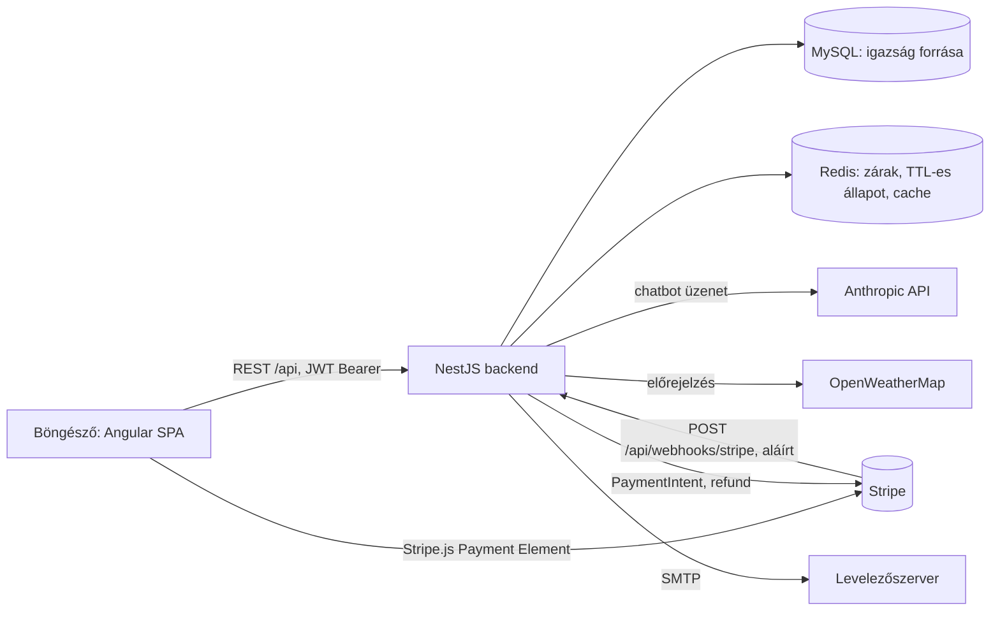

# Architektúra áttekintés

Ez a dokumentum a kódban ténylegesen meglévő állapotot írja le (a verziók a `package.json` és a telepített csomagok alapján, a viselkedés a forráskód alapján). Ahol egy állítás egy konkrét fájlhoz köthető, a fájl neve szerepel mellette.

## 1. Áttekintés

A KTE Jegyportál a Kecskeméti TE jegyértékesítő és bérletkezelő rendszere. Npm workspace-ű monorepo:

```
apps/
  backend/    NestJS 10 (telepítve: 10.4.22), TypeORM 0.3, ioredis, Stripe, Anthropic SDK, Nodemailer
  frontend/   Angular 17 (telepítve: 17.3.12), standalone komponensek, Angular Material, NgRx
docs/         dokumentáció
scripts/      stripe-listen.js (helyi webhook-továbbítás), test-e2e.js (e2e orchestráció)
.github/workflows/ci.yml   CI: backend lint+unit, backend e2e, frontend lint+Karma
docker-compose.test.yml    MySQL 8.0 + Redis 7 az e2e teszteknek
```

Futtatási környezet: Node.js >= 24 (`engines`), MySQL 8, Redis 7.

### Komponensek és kérések útvonala



Főbb folyamatok:

| Folyamat | Útvonal |
| --- | --- |
| Helyválasztás | SPA `GET /matches/:id/seats` (DB: eladott jegyek; Redis: zárak egyetlen `MGET`-tel) -> `POST .../seats/:seatId/lock` (Redis `SET NX EX`) |
| Jegyvásárlás | `POST /payments/create-intent` (JWT) -> böngészőben `stripe.confirmPayment` -> jegykiadás webhookból és/vagy `POST /payments/confirm` -> visszaigazoló oldal a `GET /payments/:id/status`-t kérdezi |
| Bérletvásárlás | `POST /season-passes/seats/:seatId/hold` (Redis hold) -> `POST /season-passes/purchase` -> Stripe megerősítés -> kiadás (lásd 6. fejezet) |
| Beléptetés | `PATCH /tickets/:id/scan` (gate/admin szerepkör) a QR-token ellenőrzésével |
| Chatbot | `POST /chatbot/message` -> a szerver hívja az Anthropic API-t (a kulcs soha nem kerül a böngészőbe) |

## 2. Frontend (`apps/frontend`)

| Téma | Megvalósítás (fájl) |
| --- | --- |
| Keretrendszer | Angular 17.3 (`@angular/core` 17.3.12), `bootstrapApplication(AppComponent, appConfig)` (`src/main.ts`), minden komponens standalone, NgModule nincs |
| UI | Angular Material 17.3 + CDK; Magyar locale (`hu-HU`, `hu`) regisztrálva |
| Állapotkezelés | NgRx 17.2 (`store`, `effects`, `store-devtools`). Három slice: `matches`, `seats`, `cart` (`src/app/state/*`, `provideState` + `provideEffects`). Az auth állapot (`core/auth/auth.service.ts`) és a chatbot (`features/chatbot/state/chatbot.signals.ts`) Angular signalokra épül, nem NgRx-re |
| Routing | `app.routes.ts`: minden oldal `loadComponent` / `loadChildren` lusta betöltéssel. Három ág: `/gate` (saját, shell nélküli oldal), `/admin` (saját `AdminShellComponent`, gyerek útvonalak `admin.routes.ts`-ben), a többi az `AppShellComponent` alatt; `**` -> 404 oldal |
| Guardok | funkcionális `CanActivateFn`-ek: `authGuard` (`/checkout`, `/checkout/confirmation`, `/profile`, `/loyalty`, `/season-pass/confirmation`, `/loans/accept/:token`), `guestGuard` (`/login`, `/register`), `gateGuard` (gate, admin, super_admin), `adminGuard` (admin, super_admin). A guard csak UX; a védelem a backendben van |
| Interceptorok | `apiBaseUrlInterceptor` (relatív URL elé `environment.apiUrl`), `authInterceptor` (Bearer token; 401-nél egyszeri csendes refresh + újrapróbálás, az auth végpontok kivételével), `errorInterceptor` (Material snackbar a hibaüzenettel; `SILENT_401` és `SKIP_ERROR_SNACKBAR` `HttpContextToken`-nel kikapcsolható) |
| API-elérés | Szolgáltatások `shared/services/*.api.service.ts` és `core/services/*` alatt, `HttpClient`-tel, a base URL: dev `http://localhost:3000/api`, prod `/api` (`environments/`) |
| Auth állapot | Access token memóriában (signal), időzített csendes refresh (a lejárat előtt 60 mp-cel), `APP_INITIALIZER` (`auth.initializer.ts`) indításkor `POST /auth/refresh`-t hív. A refresh token HttpOnly sütiben érkezik, de a válasz törzsében is, és a kliens `sessionStorage`-ban is tárolja (`kte_refresh_token`), mint tartalék |
| Székrács / stadiontérkép | `features/stadium`: `stadium-map` (SVG, 19 szektor két ívben, négy kapu, szektorszín = árkategória, vendégszektor sraffozva és nem választható), `seat-grid` (egy szektor székei, `@for` + gombok, pan/zoom: `pan-zoom.ts`, a szék állapota ikon + szín), `best-seats-panel` (legjobb egymás melletti helyek kérése), accessibility szűrő, waitlist gomb. Ugyanaz a rács "szezon módban" a bérletvásárlásnál is (`SEASON_SEAT_STATES`) |
| Kosár | NgRx `cart` slice + `core/cart/cart.facade.ts` (a komponensek csak ezt látják). Max. 6 tétel (`MAX_CART_ITEMS`), egy meccs egyszerre, lejáró zárak "lejárt" listában. A kosár `sessionStorage`-ban (`kte_cart_v1`) él; a tétel a Redis-zár `ownerToken`-jét hordozza. Vendég is rakhat kosárba (lásd 8. fejezet) |
| Stripe | `core/stripe/stripe.service.ts`: `loadStripe` lazán, `elements({clientSecret})`; a fizetőoldalak `Payment Element`-et (`elements.create('payment')`) mountolnak és `stripe.confirmPayment({redirect: 'if_required'})`-et hívnak. Jegyfizetés: `features/checkout/checkout.page.ts`; sikeres fizetés után a kliens `POST /payments/confirm`-ot hív, a visszaigazoló oldal pollingol (`logic/confirmation-polling.ts`: 3 s, majd 10 s, 15 perc után feladja) |
| Beléptető oldal | `features/gate`: kamera (`BarcodeDetector`, ennek hiányában a lazán betöltött `jsQR`), találat után `PATCH /tickets/:id/scan` |
| Admin | `features/admin`: csak olvasó oldalak: bevétel (`/admin/overview`; a meccsjegy-bevétel mellett külön blokkban a bérletbevétel), ülés-hőtérkép (`/admin/seat-sales`); a backend `GET /admin/revenue` és `GET /admin/matches/:matchId/occupancy` végpontját a frontend `AdminApiService` nem hívja |
| Tesztek | Karma + Jasmine (`ng test`), 56 `*.spec.ts`; Playwright e2e (`apps/frontend/e2e`: auth, cart, checkout, gate, season-pass-gate) |

## 3. Backend (`apps/backend`)

### 3.1 Indítás és globális beállítások (`src/main.ts`, `app.module.ts`)

| Elem | Érték |
| --- | --- |
| Globális prefix | `api`, kivéve `GET /health` |
| Body parser | a beépített kikapcsolva; `/api/webhooks/stripe` nyers törzset (`express.raw`) kap az aláírás-ellenőrzéshez, minden más `json` (1 MB limit) + `urlencoded`; `cookie-parser` |
| CORS | `CORS_ORIGINS` listából, `credentials: true` |
| Validáció | globális `ValidationPipe`: `whitelist`, `forbidNonWhitelisted`, `transform`, `enableImplicitConversion` |
| Hibakezelés | `GlobalHttpExceptionFilter` (egységes hibatörzs: `statusCode`, `timestamp`, `path`, `method`, `message`, opcionálisan `code`), `LoggingInterceptor` (metódus, URL, idő) |
| Swagger | `/api/docs`, Bearer auth, címkék modulonként |
| `trust proxy` | `app.set('trust proxy', appConfig.trustProxy)`; a `TRUST_PROXY` env-ből (`config/trust-proxy.ts`): üres/`false`/`0` = nincs proxy (alapértelmezés), egész szám = proxy-ugrások száma, vagy IP/CIDR lista; a `true` értéket az env-validáció és a parser elutasítja. Az IP-alapú limitek `req.ip`-t használnak |
| Leállítás | `enableShutdownHooks`; a Redis kapcsolat `quit`-tel zár |
| Konfiguráció | `ConfigModule.forRoot` (globális, `registerAs` névterek: `app`, `database`, `redis`, `jwt`, `stripe`, `anthropic`, `weather`, `mail`, `qr`, `loyalty`, `cron`, `waitlist`, `chatbot`) és Joi séma (`config/env.validation.ts`, `abortEarly: false`): hiányzó kötelező változónál (DB, Redis host, JWT titkok min. 16 karakter, Stripe kulcsok, Anthropic kulcs, SMTP, QR titok, URL-ek) az alkalmazás nem indul |

A `helmet` és globális throttling (`@nestjs/throttler`) nincs a függőségek között.

### 3.2 Modulok (`src/modules`)

Minden modul az `AppModule` importjai között szerepel; a `DatabaseModule` és a `RedisModule` (globális) mellett.

| Modul | Valós felelősség |
| --- | --- |
| `auth` | Regisztráció, bejelentkezés, refresh (rotációval), kijelentkezés, jelszó-visszaállítás (`PasswordResetController`/`Service`), jelszócsere bejelentkezve (`PasswordChangeService`, `POST auth/change-password`), az e-mail-cím módosításának megerősítése (`POST auth/confirm-email-change`), a regisztrációkor megadott cím megerősítése (`EmailVerificationController`/`Service`: `POST auth/verify-email/confirm`, `POST auth/verify-email/resend`), `JwtStrategy`, `JwtAuthGuard`, `OptionalJwtAuthGuard`, `RolesGuard`, `@Roles`, `@CurrentUser`, `RefreshTokenStore` (Redis) |
| `users` | `GET /users/count` (publikus regisztrációs számláló), `GET`/`PATCH /users/me`, `GET /users/me/tickets`, `POST /users/me/email-change` (`EmailChangeService`), a fiókműveletek jelszó-ellenőrzése (`CurrentPasswordVerifier`) |
| `matches` | Publikus mérkőzéslista, közelgő mérkőzések, részletek (`GET /matches`, `/matches/upcoming`, `/matches/:id`); eladási szabály: a megkezdett meccsre nem lehet venni (`match-sale.ts`) |
| `seats` | Székkatalógus (`GET /seats`), meccsenkénti székállapot (`GET /matches/:matchId/seats`), székzárolás/meghosszabbítás/feloldás, "legjobb helyek" keresés és zárolás (`BestSeatsService`), szektorkatalógus, árazás (`seat-pricing.ts`) |
| `tickets` | Saját jegyek, QR-kód (`GET /tickets/:id/qr`), beléptetés (`PATCH /tickets/:id/scan`), jegy-megjelenítés e-mailhez, lejáró job. A `cancelTicket` metódus létezik, de egyetlen kontroller vagy szolgáltatás sem hívja |
| `payments` | Stripe kliens, `create-intent`, `confirm`, `:paymentIntentId/status`, webhook (`StripeWebhookController`), jegykiadás, visszatérítés |
| `season-passes` | Bérletárak, szektorlista, szezonális székkészlet, székfoglalás (Redis hold), vásárlás, saját bérletek, meccsenkénti QR (lusta jegy-létrehozás), bérletkölcsönzés (meghívó, elfogadás, visszavonás, előnézet), `LoanReleaseJob` |
| `loyalty` | Pontkönyvelés (`LoyaltyService.award`, idempotens `(source, referenceId)` alapján), szintek, kedvezmény, pontlejárat (`SeasonCarryoverJob`), `GET /loyalty/tiers`, `/me`, `/me/transactions`, admin számláló |
| `waitlist` | Várólista teltházas meccsre, értesítés + Redis claim-ablak, lejáró job |
| `chatbot` | Anthropic-alapú asszisztens (lásd 9. fejezet) |
| `weather` | OpenWeatherMap előrejelzés meccsenként (lásd 10. fejezet) |
| `email` | SMTP küldés + Handlebars sablonok (lásd 11. fejezet) |
| `qr` | QR-token (JWT) generálás/ellenőrzés, Redis tiltólista |
| `admin` | Csak admin/super_admin: `GET /admin/health`, `/admin/revenue`, `/admin/overview`, `/admin/seat-sales`, `/admin/matches/:matchId/occupancy` (`AdminRevenueService`, `AdminOverviewService`, `AdminOccupancyService`). A bevételi riportok (`/admin/overview`, `/admin/revenue`) a meccsjegy-bevételt (egyedi jegyek, `PAID`/`USED`) és a bérletbevételt (`season_passes.price_paid`, `ACTIVE`/`EXPIRED` státusz, árkategóriánként) külön blokkban adják; a bérlet egyetlen fizetés egy szezonra, ezért meccsekre nincs szétosztva |
| `health` | `GET /health`: DB (`SELECT 1`) és Redis (`PING`) állapot, `ok` vagy `degraded` |

A `common/` könyvtár: `decorators/public.decorator.ts` (`@Public`), `filters/http-exception.filter.ts`, `interceptors/logging.interceptor.ts`, `rate-limit/` (`RateLimitGuard`, `@RateLimit`, `SlidingWindowLimiter`), `dto/pagination.dto.ts`, valamint segédfüggvények (névformázás, magyar névelő). Egyedi pipe a `common/`-ban nincs; a `ParseUUIDPipe`/`ParseIntPipe` beépített.

### 3.3 Védett és publikus végpontok

Nincs globális guard (`APP_GUARD` nincs): a védelem kontrolleren/metóduson deklarált. Az `common/route-protection.spec.ts` unit teszt minden kontrollerút ellenőrzi: vagy JWT-t igényel, vagy a `PUBLIC_ROUTES` listában indokolva szerepel; az admin/gate útvonalak szerepköreit is ellenőrzi.

| Hozzáférés | Végpontok |
| --- | --- |
| Publikus | `POST auth/register`, `auth/login`, `auth/refresh`; `POST auth/password-reset/request`, `GET auth/password-reset/:token`, `POST auth/password-reset/confirm` (rate limit); `POST auth/confirm-email-change` és `POST auth/verify-email/confirm` (a levélben kapott egyszer használható token a hitelesítő, rate limit); `POST chatbot/message` (opcionális JWT + rate limit); `GET health`; `GET loyalty/tiers`; `GET matches`, `matches/upcoming`, `matches/:id`; `GET matches/:matchId/seats`; `DELETE matches/:matchId/seats/:seatId/lock` (a feloldáshoz az `ownerToken` kell); `GET seats`; `POST webhooks/stripe` (Stripe-aláírás); `GET season-passes/prices`, `season`, `tiers/:tier/sectors`, `seats`, `loans/preview/:token`; `GET users/count`; `GET weather/match/:matchId` |
| Bejelentkezett (bármely szerepkör) | `auth/logout`, `auth/change-password`, `users/me*` (köztük `users/me/email-change`), `tickets/me`, `tickets/:id/qr`, `payments/*`, `waitlist/*`, `loyalty/me*`, `season-passes` hold/purchase/me/my/loans/QR végpontjai |
| `admin`, `super_admin` | teljes `admin/*`, `GET tickets/count`, `GET loyalty/transactions/count` |
| `gate`, `admin`, `super_admin` | `PATCH tickets/:id/scan` |

Szerepkörök (`UserRole`): `fan` (alapértelmezett, regisztrációkor), `gate`, `admin`, `super_admin`. Az `admin` és `super_admin` a kódban azonos jogú (mindenhol együtt szerepelnek). A `RolesGuard` a `@Roles` metaadatot nézi; `@Roles` nélkül nem korlátoz, ezért mindig `JwtAuthGuard`-dal együtt használják.

### 3.4 Sebességkorlátozás

Két, egymástól független Redis-alapú csúszóablak-megvalósítás van (sorted set, `zadd`/`zremrangebyscore`/`zcard`):

| Hely | Kulcs | Limit | Hiba esetén (Redis nem elérhető) |
| --- | --- | --- | --- |
| `RateLimitGuard` + `@RateLimit` (székzár: `seats:lock` 30, `seats:best` 20, `seats:extend` 20 / perc) | bejelentkezett felhasználó (`by: 'user'`) | fent | zár |
| `RateLimitGuard` + `@RateLimit` (jelszó-visszaállítás kontroller) | kliens IP (`req.ip`) | `pwreset:request` 10 / óra; `pwreset:confirm` 60 / óra (a token-ellenőrző és a megerősítő végpont közös keret) | zár (a kérést elutasítja) |
| `PasswordResetService.requestReset` | az e-mail cím SHA-256 hash-e | 3 kérés / óra / cím, regisztrált és nem regisztrált címre egyformán számolva | zár |
| `RateLimitGuard` + `@RateLimit` (fiókműveletek) | kliens IP (`req.ip`) | `pwchange:ip` 30 / óra (`auth/change-password`); `emailchange:ip` 20 / óra (`users/me/email-change`); `emailchange:confirm` 60 / óra (`auth/confirm-email-change`) | zár |
| `CurrentPasswordVerifier` | felhasználó-azonosító | `pwchange:user` 10 / óra (jelszócsere); `emailchange:user` 5 / óra (címmódosítás); minden próbálkozás számít | zár |
| `ChatbotRateLimitGuard` | bejelentkezett: felhasználó-azonosító; vendég: IP (`req.ip`) | 100 / óra, illetve 20 / óra (`CHATBOT_RATE_LIMIT_AUTH`, `CHATBOT_RATE_LIMIT_ANON`) | nyit (átengedi, figyelmeztetést naplóz) |

Az IP-alapú limitek tehát: jelszó-visszaállítás (kontrollerszintű `RateLimitGuard`), a fiókműveletek és a vendég chatbot. A bejelentkezésre (`auth/login`) és regisztrációra nincs sebességkorlát.

## 4. MySQL (TypeORM)

Kapcsolat: `DatabaseModule` (`type: 'mysql'`, `utf8mb4_unicode_ci`, `timezone: 'Z'`, `synchronize` = `DB_SYNCHRONIZE`, alapértelmezés `false`). A séma migrációkkal épül (`src/database/migrations`, 14 fájl, `1714050000000-InitialSchema` -> `1715600000000-EmailChangeTokens`); a migrációkat külön kell futtatni (`npm run migration:run`), az alkalmazás indításkor nem futtatja (nincs `migrationsRun`). Az e2e `globalSetup` lefuttatja őket. Minden entitás a `BaseEntity`-ből öröklődik: UUID `id`, `created_at`, `updated_at`, `version` (`@VersionColumn`).

Seed (`npm run seed`, `seeds/initial.seed.ts`, idempotens): admin (`admin@kte.hu`, `super_admin`), demo szurkoló (`fan@kte.hu`), beléptető (`kapu@kte.hu`, `gate`), a hiányzó szektorok, a székek (a `stadium-layout.ts` alapján 19 szektor, 5468 szék), a korábbi szezon meccseinek lezárása, közelgő felkészülési mérkőzések és a bérletárak. A szektorsorokat a `1715400000000-StadiumLayout` migráció írja be.

| Tábla (entitás) | Kulcs kapcsolatok | Üzleti szabályt hordozó megszorítások |
| --- | --- | --- |
| `users` (`User`) | 1-N jegy, bérlet, hűségtranzakció, várólista | `email` egyedi; `role`, `loyalty_tier`, `loyalty_points`, `is_active` |
| `matches` (`Match`) | 1-N jegy, várólista | index: `kickoff_at`, `status`; `capacity`, `base_price`, `is_season_pass_eligible` |
| `seats` (`Seat`) | 1-N jegy | `(section, row, number)` egyedi; `price_modifier`, `is_active` |
| `sectors` (`Sector`) | a `seats.section` kóddal kapcsolódik (nincs idegen kulcs) | `code` egyedi; `(arc, position)` egyedi; `is_away`, `is_covered`, `gate`, `price_category` |
| `tickets` (`Ticket`) | N-1 match, seat, user (`RESTRICT`); N-1 season_pass (`SET NULL`); `scanned_by_user_id` | **`uq_tickets_match_seat (match_id, seat_id)`**: egy meccs egy székéhez legfeljebb egy jegysor, státusztól függetlenül; `qr_code`, `qr_jti` egyedi; index: `stripe_payment_intent_id` (nem egyedi) |
| `season_passes` (`SeasonPass`) | N-1 user (vevő), N-1 holder user (nullable), N-1 seat | **`uq_season_passes_seat_season (seat_id, season_label)`**: egy székre szezononként egy bérlet (státusztól függetlenül); **`uq_season_passes_holder_season (holder_user_id, season_label)`**: egy fiók szezononként egy bérlet (a `NULL` birtokosúak, pl. gyerek, nem ütköznek); `qr_code` egyedi |
| `season_pass_prices` (`SeasonPassPrice`) | önálló | `(section, season_label)` egyedi (három árkategória) |
| `pass_loans` (`PassLoan`) | N-1 season_pass (`CASCADE`), lender, borrower, match | `invitation_token`, `qr_jti` egyedi; státuszok: pending, accepted, revoked, owner_entered, expired, used, cancelled, completed |
| `loyalty_transactions` (`LoyaltyTransaction`) | N-1 user (`CASCADE`) | **`uq_loyalty_source_reference (source, reference_id)`**: ugyanazért az eseményért a pont nem írható jóvá kétszer |
| `waitlist` (`Waitlist`) | N-1 user, match (`CASCADE`) | `uq_waitlist_user_match (user_id, match_id)`; státuszok: active, notified, converted, expired, cancelled |
| `password_reset_tokens` (`PasswordResetToken`) | N-1 user (`CASCADE`) | `token_hash` egyedi (csak a hash tárolt); `used_at`, `expires_at`, `password_fingerprint` |
| `email_change_tokens` (`EmailChangeToken`) | N-1 user (`CASCADE`) | `token_hash` egyedi (csak a hash tárolt); `new_email`, `used_at`, `expires_at`, `password_fingerprint` |

Státuszok: `TicketStatus` = pending_payment, paid, cancelled, refunded, used, expired; `TicketSource` = single, season_pass, loan. Egy szék egy meccsre "foglalt", ha van hozzá `pending_payment`, `paid` vagy `used` jegy (`tickets/ticket-occupancy.ts`).

## 5. Redis

A Redis **nem az igazság forrása**: az eladott jegy, a bérlet, a pontegyenleg és a felhasználó a MySQL-ben él. A Redis rövid életű, TTL-lel lejáró állapotot és gyorsítótárat tárol; kulcsait a `redis/redis.constants.ts` `RedisKeys` segédjei és két helyi kulcs (lásd a táblában) adják. Minden kulcs elé kerül a `REDIS_KEY_PREFIX` (alapértelmezés `kte:`).

| Kulcs minta | TTL | Cél | Kezelő |
| --- | --- | --- | --- |
| `seat-lock:{matchId}:{seatId}` | `SEAT_LOCK_TTL_SECONDS` (300 s) | Székzár vásárlás közben; `SET NX EX`, az érték az `ownerToken`; csak bejelentkezve (JWT) foglalható; a zárolás Lua-szkripttel egy lépésben számolja a felhasználó élő foglalásait, és `MAX_SEATS_PER_ORDER` (6) felett elutasít (409 `seat_limit_reached`); feloldás Lua-val csak egyező tokennel; a meghosszabbítás a teljes tartást az első zárolástól számítva legfeljebb `SEAT_LOCK_MAX_HOLD_SECONDS`-ra (1200 s) engedi (409 `hold_limit_reached`) | `SeatLockService` |
| `seat-lock-born:{matchId}:{seatId}` | `SEAT_LOCK_MAX_HOLD_SECONDS` | Az első zárolás ideje (epoch ms): a legnagyobb tartási idő horgonya, a meghosszabbítások nem mozdítják | `SeatLockService` |
| `seat-lock-owner:{matchId}:{userId}` | `SEAT_LOCK_MAX_HOLD_SECONDS` | Hash: a felhasználó által zárolt székek (`seatId -> ownerToken`); a darabkorlát ebből számol, de csak az élő zárakat számolja (a lejárt vagy elengedett bejegyzést a szkript törli) | `SeatLockService` |
| `discount-mutex:{matchId}:{userId}` | 10 s | Rövid zár a vevő kedvezményes helyeinek megszámolása és lefoglalása körül (`SET NX PX`, compare-and-delete): két egyszerre nyitott fizetés nem léphet túl a határon | `PaymentsService` |
| `seasonpass-hold:{season}:{seatId}` | `SEASON_PASS_HOLD_TTL_SECONDS` (900 s) | Bérletre kiválasztott szék tartása fizetés alatt; az érték csak a hold token | `SeasonPassHoldService` |
| `seasonpass-hold-owner:{season}:{userId}` | mint a hold | A felhasználó egyetlen tartott széke szezononként (`seatId|token`) | `SeasonPassHoldService` |
| `seasonpass-attempt:{user}:{section}:{season}:{holder}:{seat}` | 300 s | Vásárlási kísérlet azonosítója -> Stripe idempotency-kulcs (`seasonpass_{attemptId}`); kártyaelutasításnál törlődik | `SeasonPassesService.purchase` |
| `refresh:{userId}:{jti}` | `JWT_REFRESH_EXPIRES_IN` (7 d) | Érvényes refresh token nyilvántartása (érték: `1`); rotációnál és kijelentkezésnél törlődik | `RefreshTokenStore` |
| `rate:{scope}:{azonosító}` | az ablak hossza | Csúszóablakos sebességkorlát | `SlidingWindowLimiter`, `ChatbotRateLimitGuard` |
| `email:confirm-lock:{paymentIntentId}:{userId}` | ~ 2 x újrapróbálási késleltetés + 30 s | Elosztott zár, hogy a visszaigazoló e-mail ne menjen ki kétszer | `PaymentsService` |
| `waitlist:claim:{matchId}:{userId}` | `WAITLIST_CLAIM_TTL_SECONDS` (600 s) | A várólistás megerősítési ablaka (érték: a bejegyzés azonosítója) | `WaitlistNotificationService` |
| `waitlist:notification-lock:{matchId}` | rövid (konstans) | `SET NX` zár, hogy két egyidejű esemény ne ugyanazt a helyet ajánlja két embernek | `WaitlistNotificationService` |
| `chatbot:conv:{conversationId}` | `CHATBOT_HISTORY_TTL_SECONDS` (24 h) | Beszélgetés-előzmény, Redis lista, legfeljebb `CHATBOT_HISTORY_MAX_MESSAGES` (20) üzenet | `ChatbotHistoryService` |
| `chatbot:conv-owner:{conversationId}` | mint az előzmény | A beszélgetés tulajdonosa (`user:<id>` vagy `anon:<IP-hash>`) | `ChatbotHistoryService` |
| `chatbot:context:upcoming-matches` | `CHATBOT_CONTEXT_CACHE_TTL_SECONDS` (300 s) | A közelgő meccsek pillanatképének gyorsítótára | `ChatbotContextService` |
| `weather:match:{matchId}` | `OPENWEATHER_CACHE_TTL_SECONDS` (3600 s); sikertelen lekérésnél 60 s | Előrejelzés gyorsítótára (ez a kulcs nem a `RedisKeys`-ben van, hanem a `WeatherService`-ben) | `WeatherService` |
| `qr:deny:{jti}` | 30 nap | Visszavont QR-token tiltólistája (`qr/qr.constants.ts`) | `QrService` |

Ha a Redis nem elérhető: a székállapot-lekérdezés zár nélkülinek tekinti a székeket; a jelszó-visszaállítási limiter elutasít; a chatbot limiter átenged; a chatbot-előzmény betöltése üres listát ad. A `GET /health` ilyenkor `degraded`.

## 6. Fizetés (Stripe)

Stripe Node SDK 16 (`apiVersion: '2024-06-20'`), `PaymentIntent`-alapú, a kliens oldalon Payment Element. A pénzösszeget mindig a szerver számolja (a kliens csak szék-azonosítókat és `ownerToken`-eket küld): a `PaymentsService` a Redis-zárat, a DB-ben lévő jegyeket, a bérletes és vendég-székeket és a felhasználó hűségszintjét ellenőrzi; az árat a `match.basePrice` és a szék `priceModifier`-e adja, a kedvezményt a DB-ben lévő szintből számolja (`loyalty-discount.ts`). Egy vásárlásban legfeljebb 6 szék (`MAX_SEATS_PER_ORDER`). A HUF összeget a szerver 100-zal szorozva adja át a Stripe-nak.

### 6.1 Egyedi jegy

1. `POST /payments/create-intent` (JWT): `PaymentIntent` létrehozása; az idempotency-kulcs a felhasználóból, meccsből, az `ownerToken`-ek hash-éből és a kedvezményből áll. A metaadat hordozza a `userId`, `matchId`, `seatIds`, `ownerTokens`, `discountPercent`, `paidPrices` értékeket.
2. A böngésző `stripe.confirmPayment`-et hív.
3. **Jegykiadás két úton, ugyanazon a metóduson (`finalizePaymentIntent`) át:**
   - a Stripe webhook (`payment_intent.succeeded`), vagy
   - `POST /payments/confirm` (JWT): a szerver a Stripe-tól kérdezi le a PaymentIntentet, ellenőrzi, hogy `succeeded`, és hogy a kérő a tulajdonos; a kliens által állított státuszt nem fogadja el. Ez a kódkommentár szerint a webhook késése/kimaradása elleni tartalék ("source of truth" a webhook marad).
   A kettő közül amelyik előbb érkezik, az hozza létre a jegyeket; a másik a már létező sorokat találja, és csak az idempotens utólépéseket futtatja. Védelmek: létezés-ellenőrzés `stripe_payment_intent_id` szerint, az `uq_tickets_match_seat` egyediség és az `ER_DUP_ENTRY` elkapása.
4. Utólépések: a zárak feloldása, a jegyvásárlás nem ad hűségpontot (a pont a részvételért jár: `TicketsService.awardAttendance` a kapunál, forrás `attendance`, hivatkozás `match:<meccs>:<felhasználó>`, így az `(source, reference_id)` egyedi kulcs garantálja a meccsenkénti egyszeri jóváírást; a régi `ticket_purchase` és `pass_attendance` sorok előzményként megmaradnak), visszaigazoló e-mail (`confirmation_email_sent_at` + Redis-zár, a válasz késleltetése nélkül `setImmediate`-ből).
5. A `payment_intent.payment_failed` esemény a székzárakat újraindítja a teljes foglalási TTL-lel, hogy a vásárló újra próbálkozhasson. A `charge.dispute.created` esemény jelenleg csak naplóbejegyzést okoz.

**Szék-verseny és visszatérítés:** ha a fizetés után kiderül, hogy egy szék közben a DB-ben foglalttá vált, a többi szék jegye kiadódik, a foglalt székek tényleges árát a szerver részlegesen visszatéríti (`refunds.create`, idempotency-kulcs `refund_{intentId}`), és `seat-refund` e-mailt küld. Lejárt Redis-zár önmagában nem akadály, ha a szék még szabad. A visszatérítés sikertelensége naplózódik; újrapróbáló job nincs.

### 6.2 Bérlet (`SeasonPassesService`)

**Az aktív szezon egyetlen forrása:** az aktív `season_pass_prices` sorok (`ActiveSeasonService`, `pickActiveSeason`); a kódban nincs szezoncímke-konstans. A nyilvános bérletoldal, a hold, a vásárlás és az admin-áttekintő ugyanezt használja. Ha egyszerre két szezon árai aktívak (például júniusban a következő szezon bérleteinek értékesítése), **az újabb nyer**: amelyiknek az érvényessége később ér véget (döntetlennél a későbbi kezdés, majd a későbbi címke). Vagyis a következő szezon árainak bekapcsolása átállítja az értékesítést és az admin szezon-nézetét is; ha a futó szezont addig kell árulni, amíg le nem jár, a következő szezon sorait inaktívan kell hagyni. A már megvett bérletek a saját szezonjukat és időszakukat viselik, őket ez nem érinti. Ha nincs aktív sor, a bérletlista üres, a hold és a vásárlás 404 `no_active_season`.

1. `POST /season-passes/seats/:seatId/hold` (JWT): Redis hold (lásd 5. fejezet), felhasználónként egy szék szezononként; a bérletes székszabályt (`season-pass-seat-rule.ts`) a térkép, a számlálók, a hold és a vásárlás is ugyanúgy használja.
2. `POST /season-passes/purchase` (JWT): ellenőrzi a birtokost, a bérlet kiadhatóságát és a hold meglétét (`holdToken`) **a pénzmozgás előtt**; létrehozza a PaymentIntentet (`metadata.kind = 'season_pass'`, `seatId`, `priceRowId`, birtokos), idempotency-kulcsa a Redis kísérlet-azonosítóból jön. Ha a kérésben van `paymentMethodId`, a szerver azonnal megerősíti (`confirm: true`, átirányítás nélkül), egyébként a kliens erősíti meg a `clientSecret`-tel. A bérletár nem kap hűségkedvezményt (a kód nem alkalmazza).
3. **Kiadás két úton, ugyanazon a metóduson (`persistSeasonPassFromIntent`) át:**
   - a webhook (`payment_intent.succeeded`, `metadata.kind === 'season_pass'` -> `finalizeSeasonPassFromIntent`);
   - magában a `purchase()` kérésben, ha a PaymentIntent a létrehozás után már `succeeded` állapotú (ez a szerveroldali megerősítésnél, `paymentMethodId` megadásakor fordul elő).
   A bérlet-kiadás tehát **nem kizárólag a webhookból** történik. Idempotencia: létező bérlet `stripe_payment_intent_id` szerint, `uq_season_passes_seat_season` és `uq_season_passes_holder_season`; egyidejű webhook+kérés ütközésekor a vesztes a nyertes sorát adja vissza. A kiadás a vevő által kiválasztott székre történik, más székre soha nem cserél.
   A frontend jelenlegi folyamata: a bérletoldal `paymentMethodId` nélkül hívja a `purchase`-t (ez adja a `clientSecret`-et), a böngészőben `confirmPayment`-et hív, majd ugyanazokkal a paraméterekkel újra hívja a `purchase`-t, a hibát tolerálva ("a webhook véglegesíti").
4. Ha a bérlet nem adható ki (a szék közben elfogyott, nem a vásárolt kategóriában van, a birtokosnak már van bérlete), a teljes összeg visszajár (`refunds.create`, kulcs `refund_seasonpass_{intentId}`); `409 pass_not_issued_refunded`. A visszatérítés hibája naplózva, "manuális beavatkozás szükséges". A hold minden kimenetelnél felszabadul.
5. A `POST /payments/confirm` csak jegyekre vonatkozik (a `finalizePaymentIntent` jegy-metaadatot vár).

A Stripe-ból kiinduló értesítés egyetlen végpontja `POST /api/webhooks/stripe`: a `constructEvent` ellenőrzi az aláírást a nyers törzsön és az `STRIPE_WEBHOOK_SECRET`-en, érvénytelen aláírásnál 400. A kezelt eseménytípusok: `payment_intent.succeeded`, `payment_intent.payment_failed`, `charge.dispute.created` (`handled-stripe-events.ts`, a `scripts/stripe-listen.js` is ezt a listát használja).

## 7. Ütemezett feladatok

Várósor-rendszer (Bull, BullMQ, Agenda, stb.) **nincs**: egyik sem szerepel a `package.json`-okban. Az időzített munkát az `@nestjs/schedule` (`ScheduleModule.forRoot()`) és a `cron` csomag végzi a backend folyamatán belül. Az ütemezések elosztott zárat nem használnak.

| Név | Ütemezés | Cél | Megvalósítás |
| --- | --- | --- | --- |
| `waitlist-expire` | percenként (`CronExpression.EVERY_MINUTE`, `Europe/Budapest`) | az értesített, de meg nem erősített várólista-bejegyzések `expired`-re állítása, ha a Redis claim kulcs már lejárt; ezután a következő értesítése. Átfedést egy memóriabeli jelző akadályoz | `@Cron`, `waitlist/jobs/waitlist-expire.job.ts` |
| `loanReleaseSweep` | `LOAN_RELEASE_CRON`, alapértelmezés `0 * * * *` (óránként), `CRON_TIMEZONE` | lejárt függő meghívók `expired`-re; az elfogadott kölcsönök `completed`-re, ha a mérkőzés kezdete óta több mint 4 óra telt el, ; a kölcsönök lezárása a kapu zárásakor (`GATE_CLOSES_HOURS_AFTER`, alapértelmezés a kezdés után 4 óra) történik; a kölcsönadó pontjóváírása csak a felhasznált (a kölcsönkapó belépője beolvasva: `used`) kölcsönért jár, a fel nem használt, `completed`-re zárt kölcsönért nem | `SchedulerRegistry` + `CronJob`, `season-passes/jobs/loan-release.job.ts` |
| `ticketExpireSweep` | `TICKET_EXPIRE_CRON`, alapértelmezés `0 4 * * *` (naponta 04:00), `CRON_TIMEZONE` | a nem beolvasott `paid` jegyek `expired`-re állítása azoknál a meccseknél, amelyek kezdete több mint 24 órája volt (a kezdési időpont dönt, nem a státusz); a QR tiltólistára kerül | `SchedulerRegistry` + `CronJob`, `tickets/jobs/expire-tickets.job.ts` |
| `loyaltySeasonCarryover` | `0 3 30 6 *` (június 30., 03:00, `Europe/Budapest`; a kódban rögzített) | a pontegyenleg `LOYALTY_CARRYOVER_PERCENT` (alapértelmezés 70) százalékának megtartása, a többi `expiry` tranzakcióval lejár; a szint döntése `tierAtSeasonEnd` szerint: a szezonban elért (vagy újra kiérdemelt) szintet a következő szezon végéig megtartja, a lejárt védelmű szint a pontokból számolódik újra | `@Cron`, `loyalty/jobs/season-carryover.job.ts` |

Egyéb időzítők (nem cron): az e-mail egyszeri újrapróbálása `setTimeout`-tal; a fizetés utáni e-mailek és a visszatérítési értesítő `setImmediate`-tel.

## 8. Hitelesítés és jogosultság

| Téma | Megvalósítás |
| --- | --- |
| Jelszó | bcrypt, `BCRYPT_ROUNDS` (alapértelmezés 12, séma: 10-15) |
| Access token | JWT (HS256 a `@nestjs/jwt` alapértelmezésével), `JWT_ACCESS_SECRET`, `JWT_ACCESS_EXPIRES_IN` (15 m); tartalma `sub`, `email`, `role`. Állapotmentes, nem visszavonható; lejáratig érvényes |
| Refresh token | külön titokkal aláírt JWT (`JWT_REFRESH_SECRET`, `JWT_REFRESH_EXPIRES_IN`, 7 d) `jti`-vel; a `jti` Redis-nyilvántartása: `refresh:{userId}:{jti}`. **Rotáció:** minden `POST /auth/refresh` törli a felhasznált `jti`-t és új párt ad; a nyilvántartásban nem szereplő token elutasítva. Kijelentkezéskor a `jti` törlődik; jelszó-visszaállításkor a fiók összes refresh tokenje (`revokeAll`) |
| Süti | `kte_refresh_token`, HttpOnly, `path=/api/auth`, `SameSite=strict` és `Secure` productionben (egyébként `lax`, nem `Secure`), 7 napos `maxAge` (a süti ideje rögzített, nem a `JWT_REFRESH_EXPIRES_IN`-ből jön). A refresh végpont a sütit olvassa, ennek hiányában a törzs `refreshToken` mezőjét |
| Validálás kérésenként | `JwtStrategy.validate` minden kérésnél betölti a felhasználót az adatbázisból, inaktív fióknál 401; a szerepkört az adatbázisból veszi, nem a tokenből |
| Guardok | `JwtAuthGuard` (a `@Public`-ot figyelembe veszi), `OptionalJwtAuthGuard` (token nélkül/érvénytelen tokennel `req.user` üres, nem 401), `RolesGuard` |
| Vendég kosár | a székzáras végpontok `OptionalJwtAuthGuard`-dal nyitottak; a zár tulajdonjogát az `ownerToken` bizonyítja. Fizetni (`create-intent`) csak bejelentkezve lehet |
| Beléptető szerepkör | `gate`: csak a `PATCH tickets/:id/scan`; a QR-token JWT-jét a `QR_SIGNING_SECRET` írja alá (külön az auth titkoktól), a beolvasás a jegyet `used`-ra állítja `pessimistic_write` zárral és a `jti`-t tiltólistára teszi; második beolvasásra `already_used` |
| Admin | `admin`/`super_admin`; seedelt fiók: `admin@kte.hu` |
| Jelszó-visszaállítás | `POST auth/password-reset/request` mindig ugyanazt válaszolja (nem fedi fel, létezik-e a cím); a token `nanoid(48)`, csak a SHA-256 hash-e tárolt, érvényesség `PASSWORD_RESET_TTL_MINUTES` (60 perc), egyszer használható, az újabb kérés a korábbi linkeket érvényteleníti; megerősítéskor tranzakcióban fogy el a link és íródik át a jelszó, a jelszó közben megváltozott-e, az `password_fingerprint` ellenőrzi; utána minden refresh token törlődik és `password-changed` e-mail megy (IP-maszkolt kliensadatokkal) |
| Fiókműveletek | lásd 8.1 |
| E-mail megerősítés | A regisztráció `email_verified = false` fiókot hoz létre és megerősítő levelet küld (`email-verification`, link: `/verify-email/<token>`). Ugyanaz az egyszer használható token-mechanizmus, mint a jelszó-visszaállításnál: `nanoid(48)`, csak a SHA-256 hash tárolt (`email_verification_tokens`), érvényesség `EMAIL_VERIFICATION_TTL_HOURS` (48 óra), az újabb link a korábbiakat érvényteleníti; a token a címhez kötött (ha a fiók címe közben megváltozott, a link érvénytelen). `POST auth/verify-email/confirm` (publikus, IP-nként 60 / óra): 400 `verification_token_invalid` / `_used` / `_expired`. `POST auth/verify-email/resend` (JWT): fiókonként 4 levél / óra. **Mit tilt a megerősítetlen cím:** a bejövő bérletkölcsön-meghívókat nem látja (`GET season-passes/loans/incoming` üres), nem fogadhatja el (403 `email_not_verified`, a meghívó marad `pending`), és nem nevezhető meg bérlet birtokosaként (400 `holder_email_not_verified`). Jegyvásárlást, helyfoglalást nem érint. A migráció (`EmailVerification1716500000000`) a már létező összes fiókot (demo, személyzet, korábbi regisztrációk) megerősítettnek jelöli. Az e-mail-cím módosításának megerősítése is `email_verified = true`-ra állít |
| 2FA | **nincs megvalósítva**: a `two_factor_enabled`, `two_factor_secret` oszlopok léteznek, de a bejelentkezés és a guardok nem nézik, és nincs hozzájuk végpont |

### 8.1 Fiókműveletek

| Művelet | Végpont | Működés |
| --- | --- | --- |
| Profiladatok | `PATCH users/me` (JWT) | Csak `firstName`, `lastName`, `phoneNumber`, `dateOfBirth`; az e-mail-cím itt nem módosítható (a `forbidNonWhitelisted` validáció elutasítja). Telefonszám: számjegy, szóköz, `+`, `-`, zárójel, 6-32 karakter; az üres szöveg törli (`NULL`-ként tárolva). A profil-kitöltési hűségbónusz továbbra is egyszeri (`(source, referenceId)`). A `GET users/me` a `dateOfBirth`-öt `ÉÉÉÉ-HH-NN` formában, megerősítésre váró címmódosításnál a `pendingEmail`-t is visszaadja |
| Jelszócsere | `POST auth/change-password` (JWT), törzs: `currentPassword`, `newPassword` | Az új jelszóra ugyanaz a szabály (`@IsAccountPassword`), mint a regisztrációnál és a visszaállításnál. Hibás jelenlegi jelszó: 400 `current_password_incorrect` (szándékosan nem 401: a frontend a 401-et lejárt munkamenetnek veszi); azonos új jelszó: 400 `password_unchanged`; párhuzamos módosítás: 409 `password_changed_concurrently`. Siker: bcrypt hash, compare-and-swap a régi hash-re, a fiók élő visszaállító linkjei érvénytelenek, `revokeAll` (minden refresh token törlődik, mint visszaállításkor), majd a hívó új access + refresh tokent kap a bejelentkezéssel azonos válaszban és sütiben: ez a munkamenet bejelentkezve marad, a többi eszközön már kiadott access token a lejáratáig (15 perc) még él. `password-changed` értesítő megy (profiloldali megfogalmazással) |
| E-mail-cím módosítása | `POST users/me/email-change` (JWT), törzs: `newEmail`, `currentPassword`; `POST auth/confirm-email-change` (publikus), törzs: `token` | **Megerősítés előtt nincs hatása.** A cím a bejelentkezési azonosító és a jelszó-visszaállítás címe: azonnali cserénél egy elírás vagy egy támadó kizárhatná a tulajdonost. A kérés (jelszó kell; 400 `email_unchanged`, 409 `email_taken`) csak egy `email_change_tokens` sort hoz létre (`nanoid(48)`, csak a SHA-256 hash tárolt, `EMAIL_CHANGE_TTL_MINUTES`, alapértelmezés 60 perc, az újabb kérés a korábbit érvényteleníti), a linket (`/confirm-email/<token>`) az új címre küldi (`email-change-confirm`), a jelenlegi címet pedig értesíti maszkolt új címmel, link nélkül (`email-change-requested`); válasz 202 `{ message, pendingEmail }`. A megerősítés egy tranzakcióban: a token atomi elhasználása (egyszer használható), az új cím szabadságának újraellenőrzése (az egyedi index ütközése is 409 `email_taken`), `email` és `email_verified = true` beírása compare-and-swap-pal a jelszó-hash-re, a még élő (`pending`, `accepted`) bérletkölcsön-meghívók `borrower_email`-jének átírása, a fiók visszaállító linkjeinek érvénytelenítése (a régi postafiókba mentek). Hibakódok: 400 `email_change_token_invalid`, `email_change_token_used`, `email_change_token_expired`, `email_change_token_password_changed` (a kérés óta jelszócsere vagy visszaállítás történt). Utána a régi cím értesítést kap (`email-changed`); válasz 200 `{ message, email }`. A munkamenetek nem szűnnek meg (a kéréshez a jelszó kellett) |

Mi kötődik az e-mail-címhez: a jegyek, bérletek, hűségpontok, várólista és a bérlet-birtokos kapcsolatok a felhasználó azonosítójához kötöttek, ezért a címcsere nem érinti őket. Egyedül a bérletkölcsön-meghívó (`pass_loans.borrower_email`) címalapú: az elfogadás és a bejövő meghívók listája a címmel egyeztet, ezért a még élő meghívók követik a címet; a lezárt (felhasznált, teljesült, visszavont, lejárt) kölcsönök a régi címmel maradnak a történetben.

Az access token az `email` claimet is tartalmazza, de a `JwtStrategy` minden kérésnél az adatbázisból tölti be a felhasználót, és a `req.user.email` onnan jön: a címcsere előtt kiadott access token a lejáratáig érvényes marad, és a szerveren mindenhol már az új cím látszik. A tokenben maradt régi claimet a backend nem használja; a következő refresh már az új címmel ír alá.

## 9. Chatbot (Anthropic)

- Csak szerveroldali: `@anthropic-ai/sdk` ^0.27, a `ChatbotService` hívja, a kulcs (`ANTHROPIC_API_KEY`) csak a backend környezetében van.
- Modell: `ANTHROPIC_MODEL`; a kód alapértelmezése és az `.env.example` értéke is `claude-sonnet-5-5` (`config/anthropic.config.ts`). `max_tokens`: `ANTHROPIC_MAX_TOKENS`, alapértelmezés 1024. A hívás a béta prompt-caching API-n megy (`beta.promptCaching.messages.create`), a pillanatkép-blokk `cache_control: ephemeral` jelölést kap.
- Rendszerprompt: magyar nyelvű, szigorú számszabályokkal (szám csak a pillanatképből idézhető, a vendégszektort nem ajánlja, személyes adatot nem ad).
- Kontextus (`ChatbotContextService`): a közelgő mérkőzések (csapatok, időpont, helyszín, alapár, kapacitás, eladott/szabad helyek, hazai/idegenbeli), szektoronként ár-tartomány, szabad/eladott/zárolt szám, fedettség, kapu (a vendégszektor ár és számok nélkül), mérkőzésenként az időjárás-előrejelzés (`WeatherService`), a bérletárak, a szabályok (székfoglalás ideje, max. jegyszám, meghívó érvényessége, várólista-ablak) és a hűségprogram szabályai. A meccs-rész Redis-ben gyorsítótárazott (300 s); a hűség- és szabályrész minden híváskor újraépül.
- Előzmény: Redis lista (24 óra, max. 20 üzenet), a beszélgetés azonosítóját a szerver adja ki; csak a kezdeményező folytathatja (más hívónak 403, ismeretlen/lejárt azonosítóra 404). A vendég tulajdonosa az IP hash-e.
- Sebességkorlát: lásd 3.4. Anthropic-hiba esetén a felhasználó mindig ugyanazt a 503 üzenetet kapja, a pontos ok (401/403/404/429/529) csak a naplóba kerül.

## 10. Időjárás (OpenWeatherMap)

`WeatherService` a `https://api.openweathermap.org/data/2.5/forecast` (5 napos, 3 órás lépésű) végpontot hívja (`axios`, 8 s időkorlát, `units=metric`, `lang=hu`, város: `OPENWEATHER_CITY`). A mérkőzés kezdetéhez legközelebbi időszeletet adja vissza, ha az legfeljebb 3 órára van a kezdéstől; csapadékriasztás, ha a csapadék > 0,5 mm/óra. A kezdés előtt 120 óránál (5 nap) távolabbi vagy már elkezdődött meccsre nem ad számot (`unavailableReason`: `too_far` / `past`, ezeket nem tárolja gyorsítótárban). Az eredmény Redis-ben 1 óráig (`OPENWEATHER_CACHE_TTL_SECONDS`) él. Hiba esetén (nincs API-kulcs, hálózati hiba, üres lista) nem dob kivételt: `fallback: true` választ ad üres értékekkel, amit 60 másodpercig tárol. A `GET /weather/match/:matchId` publikus; a frontend időjárás-sávot mutat a fizetőoldalon, a chatbot pedig a kontextusába építi.

## 11. E-mail

Nodemailer SMTP-transzport (`SMTP_HOST`, `SMTP_PORT`, `SMTP_SECURE`, `SMTP_USER`, `SMTP_PASS`, feladó: `SMTP_FROM`), kapcsolatkészlettel (`pool`, 3 kapcsolat). Küldéskor egyetlen újrapróbálás van `EMAIL_RETRY_DELAY_MS` késleltetéssel (folyamaton belüli `setTimeout`); a második hiba kivételt dob, amit a hívók naplózzák. Külső levelezőszolgáltató-API (SendGrid, stb.) nincs. A sablonok Handlebars HTML-ek (`modules/email/templates/*.hbs`), induláskor lefordítva: `ticket-confirmation` (QR-képekkel), `loan-invitation`, `loan-confirmation`, `loan-cancelled`, `tier-upgraded`, `waitlist-notification`, `seat-refund`, `password-reset`, `password-changed`, `email-change-confirm`, `email-change-requested`, `email-changed`. A sablon-nevek típusos uniót alkotnak (`email.types.ts`).

## 12. Tesztelés és üzemeltetés

| Terület | Eszköz | Parancs |
| --- | --- | --- |
| Backend unit | Jest + ts-jest (`src/**/*.spec.ts`, 49 fájl) | `npm run test:backend` |
| Backend e2e | Jest (`apps/backend/test/*.e2e-spec.ts`, 1 worker), valódi MySQL és Redis a `docker-compose.test.yml`-ből (MySQL `mysql:8.0-debian` a 3307-es, Redis `redis:7-alpine` a 6380-as porton); a `globalSetup` létrehozza a `kte_jegyportal_test` adatbázist, lefuttatja a migrációkat és üríti a Redis tesztadatbázisát | `npm run test:e2e` (a gyökérből: docker up -> tesztek -> down, `scripts/test-e2e.js`) |
| Frontend unit | Karma + Jasmine, ChromeHeadless | `npm run test:frontend` |
| Frontend e2e | Playwright | `npm run e2e` az `apps/frontend`-ben |
| Lint / CI | ESLint (`--max-warnings 0`); GitHub Actions (`ci.yml`): backend lint + unit, backend e2e (MySQL 8.0, Redis 7 szolgáltatás), frontend lint + Karma | |
| Helyi indítás | `npm run start:all`: backend, frontend és a Stripe CLI webhook-továbbító együtt | |

## 13. Ismert korlátok és szándékosan hiányzó elemek

Csak a kódban ellenőrzött tények:

- Nincs üzenetsor/várósor-rendszer; az ütemezett feladatok a backend folyamatában futnak, elosztott zár nélkül (7. fejezet).
- Nincs WebSocket vagy Server-Sent Events; a székállapot és a chat HTTP-lekérdezéssel jön, a visszaigazoló oldal pollingol. (A függőségek között nincs `@nestjs/websockets` vagy socket könyvtár.)
- Nincs CDN- vagy gyorsítótár-réteg a statikus tartalom elé a repóban; nincs `helmet`, nincs globális throttling.
- A bejelentkezésnek és a regisztrációnak nincs sebességkorlátja; az IP-alapú limit a jelszó-visszaállításon és a vendég chatbotton van.
- Nincs 2FA (az oszlopok léteznek, a logika nincs). A megerősítetlen e-mail-címmel a bejelentkezés és a jegyvásárlás megy; csak a bérletkölcsön-meghívók és a bérlet-birtokosi megnevezés kér megerősített címet.
- Nincs önkiszolgáló jegylemondás/visszatérítés: a `TicketsService.cancelTicket` nincs bekötve végpontba. Automatikus visszatérítés csak akkor van, ha a fizetett hely vagy bérlet utólag nem adható ki (6. fejezet); a sikertelen visszatérítést nem próbálja újra semmi.
- A `uq_tickets_match_seat` és a bérlet-egyediségek nem státuszfüggők: egy lemondott/visszatérített jegy sora továbbra is foglalja a (meccs, szék) párt az egyediségi indexben, míg a székállapot-lekérdezés az ilyen széket szabadnak mutatja (`OCCUPYING_TICKET_STATUSES`). A bérlet-székszabály ezt külön kezeli (`season-pass-seat-rule.ts`).
- A `charge.dispute.created` csak naplózódik.
- A refresh token a sütin kívül a válasz törzsében is megy, és a kliens `sessionStorage`-ban is megőrzi tartalékként.
- A stadion-elrendezés (szektorméretek, székszám) rekonstrukció, nem felmért adat; a szektorkódok, fedettség, vendégszektor és kapuk a klub tervéből származnak (`database/stadium-layout.ts` fejléc).
- A seed fix jelszavú demófiókokat hoz létre (admin, fan, gate); ezeket éles környezetben nem szabad használni.
